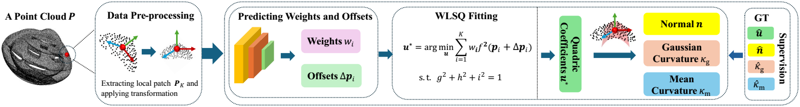

# OscuFit & N-OscuFit

OscuFit: Learning to Fit Osculating Implicit Quadrics for Point Clouds ([AAAI-26](https://ojs.aaai.org/index.php/AAAI/article/view/37405)), 

Learning to Fit Noise-Aware Osculating Implicit Quadrics for Point Clouds (Under Review).

<div align="center">
  
</div>

Clone the repository:

```bash
git clone https://github.com/bizerfr/OscuFit.git
cd OscuFit
```

The OscuFit implementation is available on the `OscuFit` or `main` branches. To use OscuFit, switch to:

```bash
git switch OscuFit
```


The N-OscuFit implementation is available on the `N-OscuFit` branch. To use N-OscuFit, switch to:

```bash
git switch N-OscuFit
```

### Data Preparation
Please download the pre-processed [ABC-Diff dataset](https://drive.google.com/file/d/1sN2rFiyHaHRYWlkZcTOx6OZzNpI08tYt/view?usp=sharing).

unzip the dataset and put it in the data folder, or modify the data root path.

### Training
configure your training settings in `options.py`, and then:

```python train.py```

### Testing
configure your testing settings in `options.py`, and then:

```python test.py```
